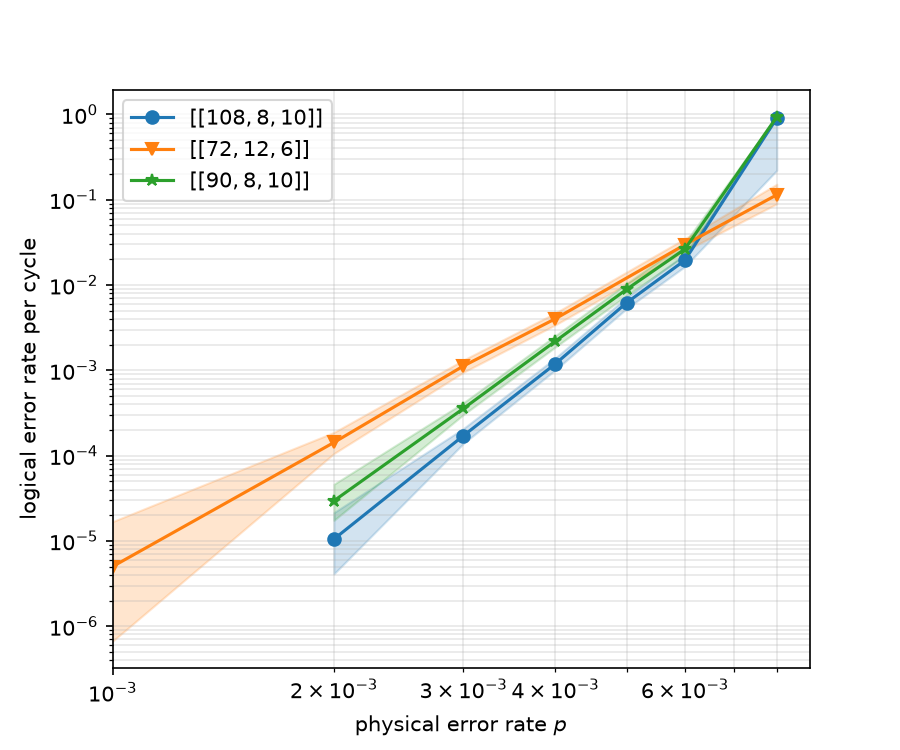

# Bivariate Bicycle Circuit

A python implmentation of the Bivariate Bicycle (BB) code in python, following the work in [this paper](https://arxiv.org/abs/2308.07915). The cicuit was generated using the  ```Stim``` library.

In particular, we implement circuit level noise, meaning given an input noise paramater $p$, the circuit expererences measurement and reset errors with probability $p$, all the $CNOT$ gates implement a 2-qubit depolarizing noise (i.e., an error channel is picked from the 15 possible 2-qubit pauli error-channels with probability $p/15$ uniformly), and all idle qubits experience depolarizing noise (single-qubit pauli errors $X,Y,Z$ are implemented with uniform probability $p/3$.) Hvaing determined the noise model, we inject these noises into the depth-8 syndrome measurement circuit as discussed in the paper to generate the stim circuit. This circuit can put into a decoder like any other stim circuit. As an example, we implement the Belief-Propagation with an Ordered-Statistics Decoder (BP-OSD) from the ```stimbposd``` library. Please see [decode_bb_circuit](run_scripts/decode_bb_circuit.ipynb) for some examples and data.

## Installation
1. Clone the repository:
   ```bash
   git clone https://github.com/sou-27/Bivariate-Bicycle-Circuit
   git
   cd "Bivariate-Bicycle-Circuit"

2. Create a virtual environment and install the package in editable mode:
   ```bash
   python -m venv venv
   source venv/bin/activate  # On Windows: venv\Scripts\activate
   pip install -e .

## Usage
One may define the BB circuit by instantiating the ```BivBic``` class with the following parameters.

__Arguments__

1. l(int) : Input matrix dimension parameter.
2. m(int) : Input matrix dimension parameter.
3. A_vars(list) : Defines the matrix $A$ with the encoding $x \cong 0, y\cong 1$. Then a trinomial is a list of ordered pairs, such that the first parameter in the  pair is 0 or 1 ($x$ or $y$) and the second parameter is the exponent, For example, $A = x + y + y^2$ is encoded as ```A_vars = [[0,1], [1,1], [1,2]]```.
4. B_vars(list) : Defined the matrix $B$, in the format shown above.
5. p(float) : Fault rate to be used in the noise model.
6. rounds(int) : Number of rounds of syndrome measurement.
7. code_capacity(bool) : If True, circuit is generated udner code-capacity noise, else circuit level noise is used. Set to False by default.

As an example, consider the following code snippet that generates the famouse $[[72,12,6]]$ BB circuit where $A =  x^3 + y + y^2$ and $B = y^3 + x + x^2$.

```
from src.generate_BBcode import BivBic

l = 6
m = 6
A_vars = [[0,3], [1,1], [1,2]]
B_vars = [[1,3], [0,1], [0,2]]
p = 0.05
rounds = 6

code = BivBic(l = l, m = m, A_vars = A_vars, B_vars = B_vars, p = p, rounds = rounds)
```
Now the BB circuit is an attribute of the ```BivBic``` class.
```
circuit = code.circuit
```
Another useful attribute of this class is the ```calculate_distance()``` module, which calculates the distance of the given circuit by solving the appopriate sat optimization problem. As this is a costly operation (it is an NP-hard problem), the code distance is only calculated upon explicit request. See the [notebook](run_scripts/decode_bb_circuit.ipynb) for further details on implementation.

## Some data extracted from BP-OSD



In the above plot we have shown some logical error rate data for the BB codes $[[72,12,6], [90,8,10], [108,8,10]]$. This computation was done using the ```sinter``` library. Please check-out this [script](run_scripts/sinter_analyse.py) for details.
